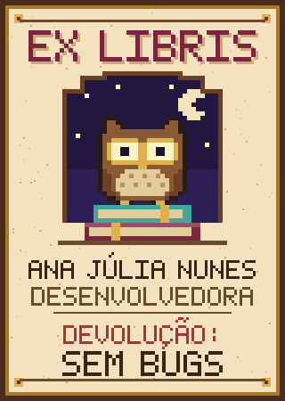
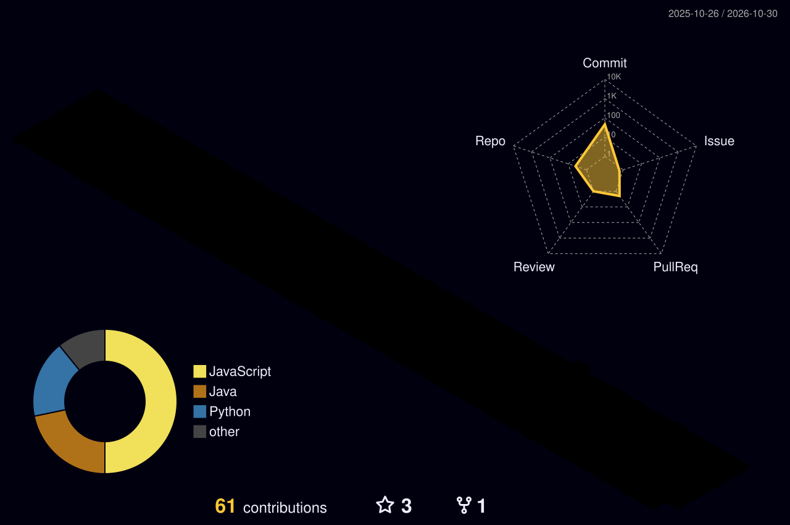
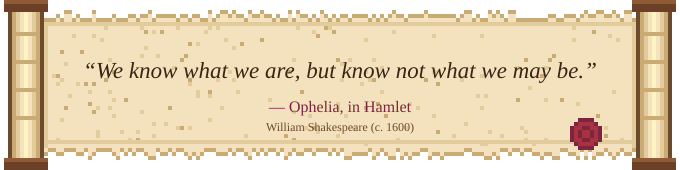

  

<table>
  <tr>
    <td width="42%" align="center" valign="top">
      
       
      
    </td>
    <td width="58%" valign="top">
      <h3> About the author</h3>
      
Software Engineer who treats code like a good book: a clear beginning, a solid middle and an ending with no bugs.

      
I work with <b>Java</b>, <b>React</b>, <b>TypeScript</b>, <b>Python</b> and other technologies. 

      
I build full-stack web platforms and desktop tools for <b>applied metrology</b>, where a measurement is only as good as the software behind it.

      
Fluent in English, learning German, and always looking for international opportunities.

    </td>
  </tr>
</table>

###  The grimoire

  

  
  
  
  
  
  
  

**Focus:** full-stack web development, REST APIs and desktop applications. 
**Languages:** Portuguese (native), English (fluent), German (intermediate).

###  The oracle

  

###  Chapters in progress

| Volume | What it's about |
| --- | --- |
| **[Plataforma CEM](https://github.com/Anaju-h/Plataforma-CEM)** | Web platform for SENAI's Metrology Center of Excellence: public site, customer area and internal quoting workflow. React + Tailwind on the front end, Quarkus + SQL Server on the back end. |
| **[METRA](https://github.com/Anaju-h/METRA-Relatorios)** | Desktop app that automates the post-processing of metrology reports. Python, PySide6 and PyMuPDF. |
| **[GYNLOG](https://github.com/Anaju-h/ProjetoIntegrador)** | Fleet expense management system, built as a team project. Java Swing. |
| **Seasonal Climate Patterns** | Undergraduate research: K-Means clustering of seasonal climate patterns across Brazilian regions using INMET data. |

###  Marginalia

A new page with every commit.

  

