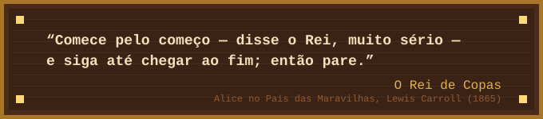

  

<table>
  <tr>
    <td width="42%" align="center" valign="top">
      
       
      
    </td>
    <td width="58%" valign="top">
      <h3> Sobre a autora</h3>
      
Estudante de tecnologia que trata código como um bom livro: começo, meio e um fim sem bugs.

      
Escrevo quase tudo em <b>Java</b> e uso <b>Python</b> quando preciso conversar com dados.

      
Na iniciação científica, agrupo <b>padrões climáticos sazonais com K-Means</b> a partir dos dados do INMET.

      
Nas horas vagas, leio fantasia e sigo acumulando livros na estante.

      
<b>Onde me encontrar:</b> <a href="https://github.com/Anaju-h">github.com/Anaju-h</a>

    </td>
  </tr>
</table>

###  O grimório

  

**Feitiços dominados:** orientação a objetos, análise de dados e desenvolvimento web. 
**Idiomas:** Português (nativo).

###  O oráculo

  

###  Capítulos em andamento

| Volume | Do que se trata |
| --- | --- |
| **Padrões Estacionais com K-Means** | Iniciação científica: agrupamento de padrões climáticos sazonais com dados do INMET, por região do Brasil. |
| **Plataforma do Laboratório de Metrologia** | Plataforma web para o laboratório de metrologia do SENAI: site, área do cliente e fluxo interno de orçamentos. |

###  Marginália

Uma página nova a cada commit.

  

